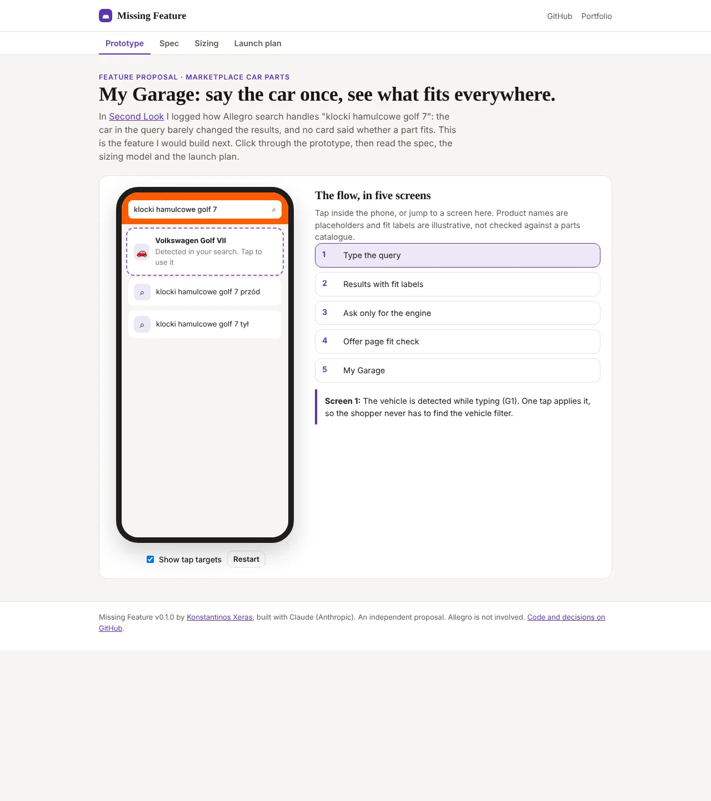

# Missing Feature

**A feature proposal with a clickable prototype: My Garage reads the car from the search query and labels every car part with whether it fits.**

**Current version:** 0.1.0

Live: https://kostasxeras.com/missing-feature/



## The question

In Second Look I logged how Allegro search handles a car parts query that names the car. The car barely changed the results and no result card said whether a part fits. This project takes the next step a PM would take: define the feature, prototype it, size it honestly and plan the launch.

## Who it is for

- Hiring managers who want to see a full feature proposal, from evidence to launch plan
- Search and marketplace teams working on fitment-dependent products

## What is inside

- **Clickable phone prototype** with five screens: vehicle detected while typing, results with fit labels, engine question, offer page fit check, My Garage
- **Screen notes** that tie each screen to a requirement
- **Spec**: problem, evidence and its limits, users, eight prioritised requirements, edge cases, non-goals
- **Sizing model** with nine editable inputs, all placeholders, showing extra orders, avoided returns and monthly value
- **Launch plan**: offline parser check, A/B test, flagged garage, separate ads test, risks and the decision I would ask for

## Data and sources

The only evidence comes from the [Second Look test log](https://kostasxeras.com/second-look/) (8 queries on allegro.pl, 21 November 2026). Product names in the prototype are placeholders and fit labels are illustrative. Sizing inputs are round example numbers, not estimates of Allegro's business. Allegro is not involved in this proposal.

## Decisions

- [Detect the car from the query instead of asking first](docs/decisions/0001-detect-dont-ask.md)
- [Rank fitting parts first, never hide the rest](docs/decisions/0002-rank-not-hide.md)
- [Ads fitment rule as a separate decision](docs/decisions/0003-ads-separate.md)
- [Sizing with placeholders, not guesses](docs/decisions/0004-placeholder-sizing.md)

## How I would measure success

No usage data yet. These are the measures I would track, with targets to set after real use.

| Measure | Definition | Target |
|---|---|---|
| Search to purchase | Conversion of car parts searches that name a car | [baseline] to [target] |
| Wrong-fit returns | Returns with reason "does not fit" per 1,000 orders | [baseline] down [x]% |
| Vehicle detection precision | Share of detected vehicles that are correct, hand-labelled | [x]% before launch |

## What I would do next

1. Test the prototype with [5] drivers who bought a car part in the last three months
2. Write the vehicle parser and measure precision on [n] real queries
3. Add the ads team's view to the launch plan

## My role

I framed the problem, made the product calls and wrote the conclusions. 

## Run it yourself

One HTML page with no build step. Open `index.html` through any local web server, for example `python3 -m http.server`, then go to http://localhost:8000.

## Repo layout

```
index.html               The page
app.css                  Shared base styles
docs/product-brief.md    Problem, users, goals, scope
docs/case-study.md       Approach, decisions, findings, next steps
docs/decisions/          One record per real tradeoff
docs/screenshots/        Desktop and mobile
```
